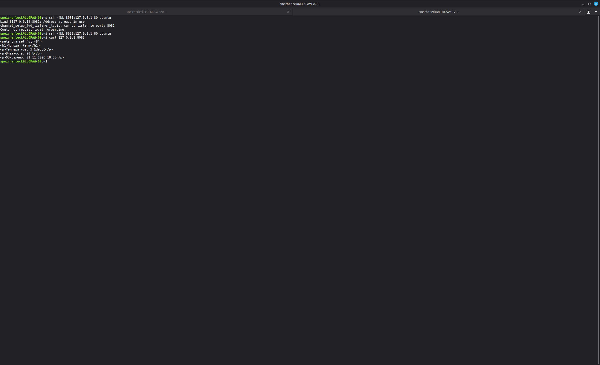
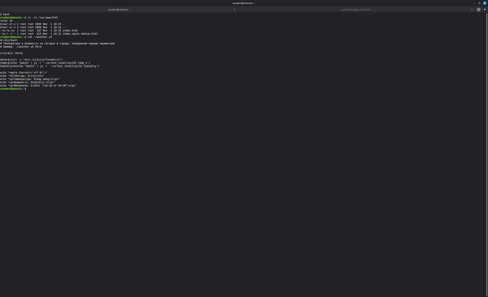

# ooops-practice-02 — автоматизация в Linux: погода по крону на nginx

Практическая работа №2: bash-скрипт, который принимает город и выводит температуру
и влажность на текущий день (сервис [wttr.in](https://github.com/chubin/wttr.in) в формате
JSON, разбор через `jq`). Скрипт запускается по крону раз в минуту, вывод сохраняется
в `index.html` дефолтного сайта nginx.

## Содержимое репозитория

| Путь | Описание |
| --- | --- |
| [`weather.sh`](weather.sh) | Скрипт: город → температура и влажность в виде HTML |
| [`cron/crontab`](cron/crontab) | Задание планировщика для пользователя `student` |
| [`screenshots/`](screenshots/) | Скриншоты, подтверждающие выполнение каждого шага |
| `README.md` | Описание работы |

## Стенд

| Параметр | Значение |
| --- | --- |
| Гипервизор | QEMU/KVM (virt-manager) |
| Гостевая ОС | Ubuntu Server 24.04.3 LTS |
| Имя ВМ | `Ubuntu24.04LTS` (стенд из практики №1) |
| Сеть | виртуальная сеть `default`, NAT |
| IP-адрес ВМ | `192.168.122.95` |
| Пользователь | `student` (вход с хоста командой `ssh ubuntu`) |
| Часовой пояс | `Asia/Yekaterinburg` (UTC+5) |
| Веб-сервер | nginx 1.24.0 |

## Ход работы

### 1. Установка веб-сервера

```bash
sudo apt update && sudo apt install nginx
```


Проверка, что сервер отвечает:

```bash
curl 127.0.0.1
```

На скриншоте сервер уже отдаёт страницу, сгенерированную скриптом из шага 4:


### 2. Проброс порта с хоста в гостевую систему

ВМ работает в NAT-сети libvirt, поэтому порт пробрасывается SSH-туннелем с хост-машины.
Порт 8080 на хосте занят другим сервисом, поэтому используются другие порты: на 8081
туннель уже был поднят раньше (отсюда `Address already in use`), второй поднят на 8083.

```bash
ssh -fNL 8083:127.0.0.1:80 ubuntu
curl 127.0.0.1:8083
```



### 3. Запрос погоды в JSON и парсинг через jq

```bash
sudo apt install jq
curl wttr.in/Perm?format=j2 | jq '.["current_condition"][0] | .temp_C,.humidity'
```

`format=j2` — облегчённый JSON от wttr.in; `jq` достаёт из первого элемента
`current_condition` температуру (`temp_C`) и влажность (`humidity`):


### 4. Права доступа и скрипт

Скрипт запускается от пользователя `student`, поэтому на индексный файл дана запись всем:

```bash
sudo touch /var/www/html/index.html
sudo chmod 666 /var/www/html/index.html
ls -la /var/www/html
```

Скрипт [`weather.sh`](weather.sh) лежит в домашнем каталоге `student` и принимает
город первым параметром:

```bash
chmod +x ~/weather.sh
~/weather.sh Perm > /var/www/html/index.html
```



### 5. Добавление задания в планировщик

```bash
crontab -e
crontab -l
```

В crontab добавлена строка (файл [`cron/crontab`](cron/crontab)) — запуск раз в минуту
с перезаписью индексного файла:

```
* * * * * /home/student/weather.sh Perm > /var/www/html/index.html
```


### 6. Проверка в браузере

Страница открывается с хоста по адресу `http://localhost:8081`, время в строке
«Обновлено» меняется раз в минуту:


## Результат

* nginx установлен и отдаёт дефолтный сайт, с хоста он доступен через проброс порта по SSH;
* скрипт `weather.sh` получает погоду с wttr.in в формате JSON и через `jq` достаёт
  температуру и влажность для переданного города;
* по крону скрипт запускается раз в минуту и перезаписывает `/var/www/html/index.html`;
* в браузере отображаются актуальные температура и влажность в Перми: 5 °C, 90 %.
